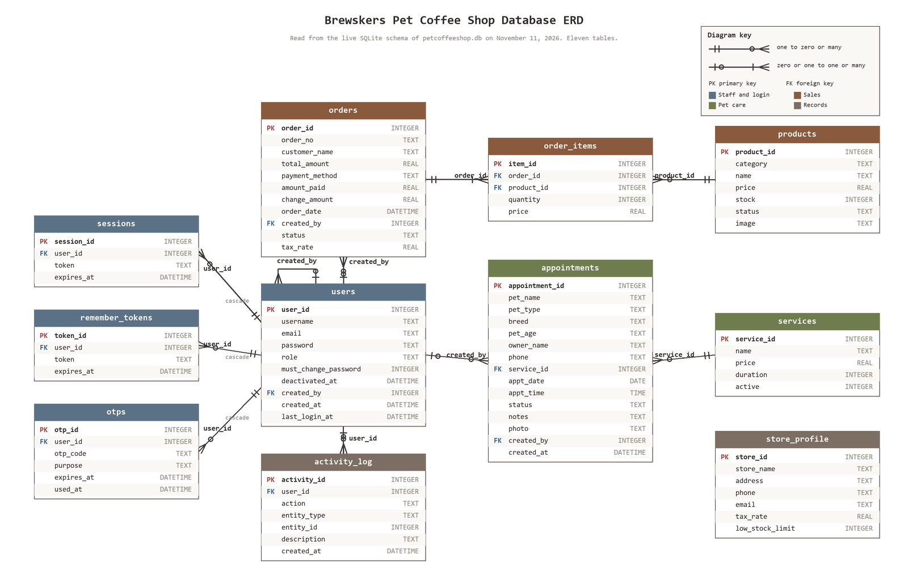

# Brewskers Database Documentation

This document describes the database behind the Brewskers pet coffee shop
system. It covers every table, column, key, relationship, index and the
normalization reasoning behind the design. The entity relationship diagram
sits next to this file as erd.png and was generated directly from the live
database, so it matches the real schema exactly.

## Overview

The system stores its data in SQLite, a file based relational database. The
database file is petcoffeeshop.db in the project root. Every part of the
backend connects through one function, connect_db in backend/database.py,
which opens the file with foreign key enforcement turned on. When the
server starts, migrate_db checks the file, restores the newest valid backup
if the file was lost, and adds any columns or indexes that older databases
are missing. Because it is a single file, copying it is a complete backup,
which the Backup Manager in the admin area and scripts/backup_db.py both use.

The schema holds eleven tables grouped into four areas:

| Group | Tables | What it covers |
|---|---|---|
| Staff and login | users, sessions, remember_tokens, otps | Accounts, roles, active logins, remember me cookies and one time codes |
| Sales | orders, order_items, products | Checkout records, the lines inside each order and the sellable catalog |
| Pet care | services, appointments | Bookable pet services and the appointment schedule |
| Store records | store_profile, activity_log | Store details and settings, plus the audit trail |

## Entity Relationship Diagram

The diagram is saved as [erd.png](erd.png).

It uses crow's foot notation:

| Symbol | Meaning |
|---|---|
| Two short bars | Exactly one |
| A bar and a circle | Zero or one, meaning the link is optional |
| Three prongs | Many |
| PK | Primary key |
| FK | Foreign key |

The three login helper tables (sessions, remember_tokens, otps) carry the
word cascade because their foreign keys use ON DELETE CASCADE, so removing
a user account also removes their leftover login records. The users table
also references itself through created_by, drawn as the small loop above
the table, which records which admin created each staff account.

The ERD image (docs/erd.png) documents the schema visually. After any schema
change, update the table listing in this document and regenerate the diagram
so the ERD stays exactly as accurate as the database itself.
with `py -m pip install pillow`.

## Table Reference

Every column below is listed with its SQLite data type, whether it is a
key, whether it must be filled, its default and its purpose.

### users

One row per staff account. The role column decides what each person can
see and do, and the five allowed roles are described in the project
analysis document.

| Column | Type | Key | Required | Default | Purpose |
|---|---|---|---|---|---|
| user_id | INTEGER | PK | Yes | Auto | Identifies the account |
| username | TEXT | UNIQUE | Yes | None | Login name shown across the app |
| email | TEXT | UNIQUE | Yes | None | Contact address used for password reset codes |
| password | TEXT | | Yes | None | Werkzeug password hash, never the plain password |
| role | TEXT | | Yes | staff | Access level: admin, cashier, inventory, appointments or viewer |
| must_change_password | INTEGER | | Yes | 0 | One when the account must set a new password at next login |
| deactivated_at | DATETIME | | No | NULL | Timestamp when the account was turned off, NULL while active |
| created_by | INTEGER | FK to users | No | NULL | The admin account that created this one |
| created_at | DATETIME | | No | Current time | When the account was made |
| last_login_at | DATETIME | | No | NULL | Shown on the staff page |

### sessions

One row per browser login. Rows are deleted when a person logs out, when
the session expires or when their account is deactivated.

| Column | Type | Key | Required | Default | Purpose |
|---|---|---|---|---|---|
| session_id | INTEGER | PK | Yes | Auto | Identifies the session |
| user_id | INTEGER | FK to users, cascade | Yes | None | The logged in account |
| token | TEXT | UNIQUE | Yes | None | Random session token kept in the cookie |
| expires_at | DATETIME | | Yes | None | When the login stops being valid |

### remember_tokens

One row per remember me cookie. Works like sessions but lives longer so a
cashier can reopen the POS without typing the password again.

| Column | Type | Key | Required | Default | Purpose |
|---|---|---|---|---|---|
| token_id | INTEGER | PK | Yes | Auto | Identifies the cookie record |
| user_id | INTEGER | FK to users, cascade | Yes | None | The remembered account |
| token | TEXT | UNIQUE | Yes | None | Random token stored in the cookie |
| expires_at | DATETIME | | Yes | None | When the cookie stops being valid |

### otps

One time codes emailed for password resets. A code can only be used once
and expires on its own.

| Column | Type | Key | Required | Default | Purpose |
|---|---|---|---|---|---|
| otp_id | INTEGER | PK | Yes | Auto | Identifies the code |
| user_id | INTEGER | FK to users, cascade | Yes | None | The account the code was sent to |
| otp_code | TEXT | | Yes | None | The six digit code |
| purpose | TEXT | | Yes | None | What the code is for, currently password reset |
| expires_at | DATETIME | | Yes | None | When the code stops working |
| used_at | DATETIME | | No | NULL | When the code was used, NULL while unused |

### store_profile

A single row holding the store details that appear on receipts and the
settings used across the app. The admin Settings page edits this row.

| Column | Type | Key | Required | Default | Purpose |
|---|---|---|---|---|---|
| store_id | INTEGER | PK | Yes | Auto | Identifies the row |
| store_name | TEXT | | Yes | None | Shop name printed on receipts |
| address | TEXT | | No | None | Shop address printed on receipts |
| phone | TEXT | | No | None | Shop phone number printed on receipts |
| email | TEXT | | No | None | Shop email printed on receipts |
| tax_rate | REAL | | Yes | 12.0 | Value added tax percent charged at checkout, editable in Settings |
| low_stock_limit | INTEGER | | Yes | 5 | Stock count at which an item is flagged low |

### products

One row per sellable item, from coffee to pet treats.

| Column | Type | Key | Required | Default | Purpose |
|---|---|---|---|---|---|
| product_id | INTEGER | PK | Yes | Auto | Identifies the product |
| category | TEXT | | Yes | None | Menu group such as Coffee, Pastry or Pet Treats |
| name | TEXT | UNIQUE | Yes | None | Product name, unique among all products |
| price | REAL | | Yes | None | Selling price in pesos |
| stock | INTEGER | | Yes | 0 | Units on the shelf, lowered by every sale |
| status | TEXT | | No | available | available shows the item, hidden keeps the record off the POS |
| image | TEXT | | No | NULL | Path of the uploaded picture under static product_images |

### orders

One row per checkout. An order starts as queued, then a cashier marks it
completed, or it is cancelled.

| Column | Type | Key | Required | Default | Purpose |
|---|---|---|---|---|---|
| order_id | INTEGER | PK | Yes | Auto | Identifies the order |
| order_no | TEXT | UNIQUE | Yes | None | Receipt number shown to the customer |
| customer_name | TEXT | | No | NULL | Optional walk in name, NULL means unnamed walk in |
| total_amount | REAL | | Yes | None | Final charged amount including tax |
| payment_method | TEXT | | No | cash | cash, gcash or card |
| amount_paid | REAL | | No | NULL | Cash handed over, for cash receipts |
| change_amount | REAL | | No | NULL | Change returned, for cash receipts |
| order_date | DATETIME | | No | Current time | When the checkout happened |
| created_by | INTEGER | FK to users | No | NULL | The cashier who rung up the sale |
| status | TEXT | | Yes | queued | queued, completed or cancelled |
| tax_rate | REAL | | Yes | 8.0 | Tax percent applied to this sale, snapshotted at checkout |

### order_items

The lines inside an order. One row per product per order, which is how a
cart of many items is stored without repeating groups.

| Column | Type | Key | Required | Default | Purpose |
|---|---|---|---|---|---|
| item_id | INTEGER | PK | Yes | Auto | Identifies the line |
| order_id | INTEGER | FK to orders | Yes | None | The order this line belongs to |
| product_id | INTEGER | FK to products | Yes | None | The product sold on this line |
| quantity | INTEGER | | Yes | None | Units sold on this line |
| price | REAL | | Yes | None | Unit price charged at sale time, snapshotted per line |

### services

One row per bookable pet care service such as grooming or a vet check.

| Column | Type | Key | Required | Default | Purpose |
|---|---|---|---|---|---|
| service_id | INTEGER | PK | Yes | Auto | Identifies the service |
| name | TEXT | | Yes | None | Service name |
| price | REAL | | Yes | None | Service price in pesos |
| duration | INTEGER | | No | 30 | Session length in minutes |
| active | INTEGER | | Yes | 1 | One while bookable, zero takes it off the booking form |

### appointments

One row per booking for a pet. The schedule calendar and the appointments
page read this table.

| Column | Type | Key | Required | Default | Purpose |
|---|---|---|---|---|---|
| appointment_id | INTEGER | PK | Yes | Auto | Identifies the booking |
| pet_name | TEXT | | Yes | None | Name of the pet |
| pet_type | TEXT | | No | Dog | Dog, Cat or Other |
| breed | TEXT | | No | None | Breed of the pet |
| pet_age | TEXT | | No | None | Age of the pet |
| owner_name | TEXT | | Yes | None | Owner who brings the pet |
| phone | TEXT | | Yes | None | Owner contact number, Philippine format |
| service_id | INTEGER | FK to services | Yes | None | The booked service |
| appt_date | DATE | | Yes | None | Day of the visit, cannot be in the past |
| appt_time | TIME | | Yes | None | Start time of the visit |
| status | TEXT | | No | scheduled | scheduled, completed or cancelled |
| notes | TEXT | | No | NULL | Guest notes up to 500 characters |
| photo | TEXT | | No | NULL | Stored pet photo reference |
| created_by | INTEGER | FK to users | No | NULL | The staff member who booked it |
| created_at | DATETIME | | No | Current time | When the booking was made |

### activity_log

The audit trail. Most write actions in the app add one row here, which the
admin dashboard and data management screens show.

| Column | Type | Key | Required | Default | Purpose |
|---|---|---|---|---|---|
| activity_id | INTEGER | PK | Yes | Auto | Identifies the entry |
| user_id | INTEGER | FK to users | No | NULL | Who did it, NULL for system actions |
| action | TEXT | | Yes | None | Short action code such as login or csv_imported |
| entity_type | TEXT | | No | NULL | Kind of record touched, such as product |
| entity_id | INTEGER | | No | NULL | Row id of the record touched |
| description | TEXT | | Yes | None | Human readable line shown in the feed |
| created_at | DATETIME | | No | Current time | When it happened |

## Relationships

The system uses INTEGER primary keys everywhere and links tables with
foreign keys. Foreign key enforcement is switched on for every connection,
so the database itself refuses rows that point at records that do not
exist. The table below lists every relationship with its meaning.

| Child table | Column | Points to | Cardinality | On delete |
|---|---|---|---|---|
| sessions | user_id | users.user_id | One user has zero or many sessions | Cascade |
| remember_tokens | user_id | users.user_id | One user has zero or many cookies | Cascade |
| otps | user_id | users.user_id | One user has zero or many codes | Cascade |
| orders | created_by | users.user_id | One cashier has zero or many orders, and every order has zero or one cashier | No action |
| order_items | order_id | orders.order_id | Every order has one or more lines, and every line has exactly one order | No action |
| order_items | product_id | products.product_id | One product appears in zero or many order lines, and every line has exactly one product | No action |
| appointments | service_id | services.service_id | One service has zero or many bookings, and every booking has exactly one service | No action |
| appointments | created_by | users.user_id | One staff member has zero or many bookings | No action |
| activity_log | user_id | users.user_id | One user has zero or many log entries | No action |
| users | created_by | users.user_id | One admin has zero or many created accounts | No action |

Checkout always refuses an empty cart, so an order has at least one line,
which is why order_items to orders is one or more rather than zero or more.
The maintenance tools delete child rows first, for example order_items
before orders, so the no action rules never block a cleanup.

Data that belongs together is fetched with JOIN queries rather than
copied between tables. For example the order pages join orders with users
to show the cashier name, the reports join order_items, orders and
products to compute best sellers, and the appointments page joins
appointments with services to show what each pet is booked for.

Product names are checked for duplicates before any insert. The add
product form rejects a name that already exists, including hidden items,
and the CSV import updates an existing name instead of adding a second
row. A unique index backs both rules at the database level.

## Indexes

Unique constraints create unique indexes automatically on users.username,
users.email, sessions.token, remember_tokens.token and orders.order_no.
The schema also creates these search indexes for the screens that filter
large tables:

| Index | Table and columns | Helps |
|---|---|---|
| idx_products_name | products(name), unique | Keeps product names unique at the database level |
| idx_orders_status | orders(status) | Order queue and history status filters |
| idx_orders_date | orders(order_date) | Date windowed reports |
| idx_appointments_date | appointments(appt_date, status) | Schedule calendar and status chips |
| idx_products_status | products(status, category) | Inventory category filter that skips hidden items |
| idx_activity_created | activity_log(created_at) | Newest first activity feed |

The database file also carries a second index on activity_log(created_at)
named idx_activity_log_created that was created by the schema before the
migration path added the identical one above. Both work and neither
affects correctness, so it was left in place to avoid touching live files.

## Data Types and Value Rules

TEXT holds names and short descriptions, INTEGER holds counts, flags and
identifier keys, REAL holds money, and DATE, TIME and DATETIME hold
schedule and audit moments. Status and role columns store small fixed
value sets, and the application checks every one of them before saving:
order status is queued, completed or cancelled, appointment status is
scheduled, completed or cancelled, product status is available or hidden,
pet type is Dog, Cat or Other, payment method is cash, gcash or card, and
user role is one of the five roles listed above. Money is rounded to two
decimal places through the Decimal type during checkout so totals never
drift from the receipt.

## Normalization

The design follows first, second and third normal form.

### First normal form

Every column holds one atomic value and there are no repeating groups. A
cart is not stored as a list inside the order row, instead each product
in the cart becomes its own order_items row with its own quantity and
price. Pet details are separate columns, never a combined field, and the
activity log stores one action per row.

### Second normal form

Every table uses a single column surrogate primary key, so there are no
composite keys and no column can depend on only part of a key. Every non
key column describes the whole row it sits in. For example order_items
keeps quantity and price on the line row, not on the order or the
product, because both values belong to that specific line.

### Third normal form

No non key column depends on another non key column. Facts live in one
place and are joined when needed:

| Fact | Stored once in | Fetched by |
|---|---|---|
| Cashier name and role | users | orders.created_by joined to users |
| Product name and category | products | order_items.product_id joined to products |
| Service name, price and duration | services | appointments.service_id joined to services |
| Tax rate and low stock limit | store_profile | Read from the single settings row |
| Store name and contact details | store_profile | Receipt rendering |

Two columns intentionally copy a value at the moment of a sale, and both
are deliberate snapshots rather than normalization mistakes:

| Column | Why it is copied |
|---|---|
| order_items.price | The unit price actually charged on that line. If the store later changes a product price, old receipts and sales reports must still show what was really charged, so the price belongs to the sale line, not only to the product. |
| orders.tax_rate | The tax percent applied to that sale. When the store changes its rate in Settings, past receipts keep the rate that was charged that day. |

Both snapshots describe the sale itself, which happened at one moment
with one price and one rate, so each value depends on its own row and not
on a chain of non key columns. This is the standard pattern for receipts
and order history.

## Keeping the Schema and the Diagram in Step

The schema lives in backend/database.py, the migrations in migrate_db keep
older files up to date. After any schema change, run the generator again and
update the table listing in this document, and the ERD stays exactly as
accurate as the database itself.
